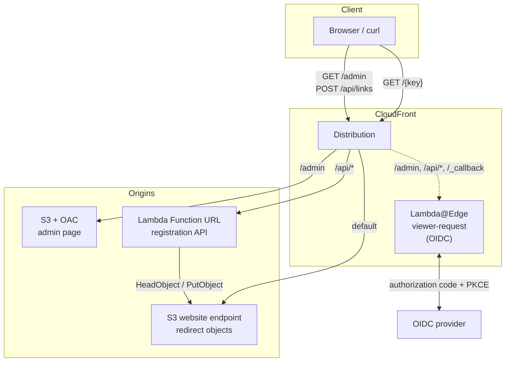
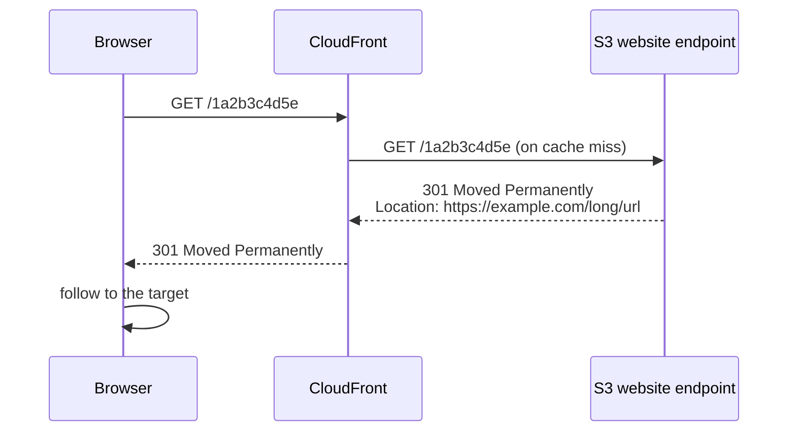
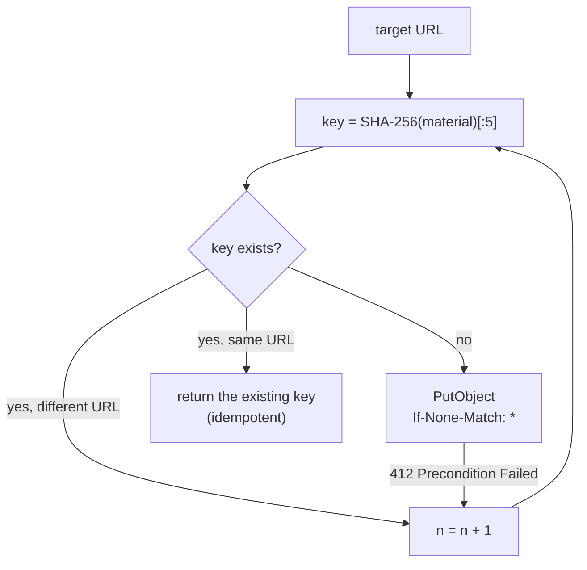
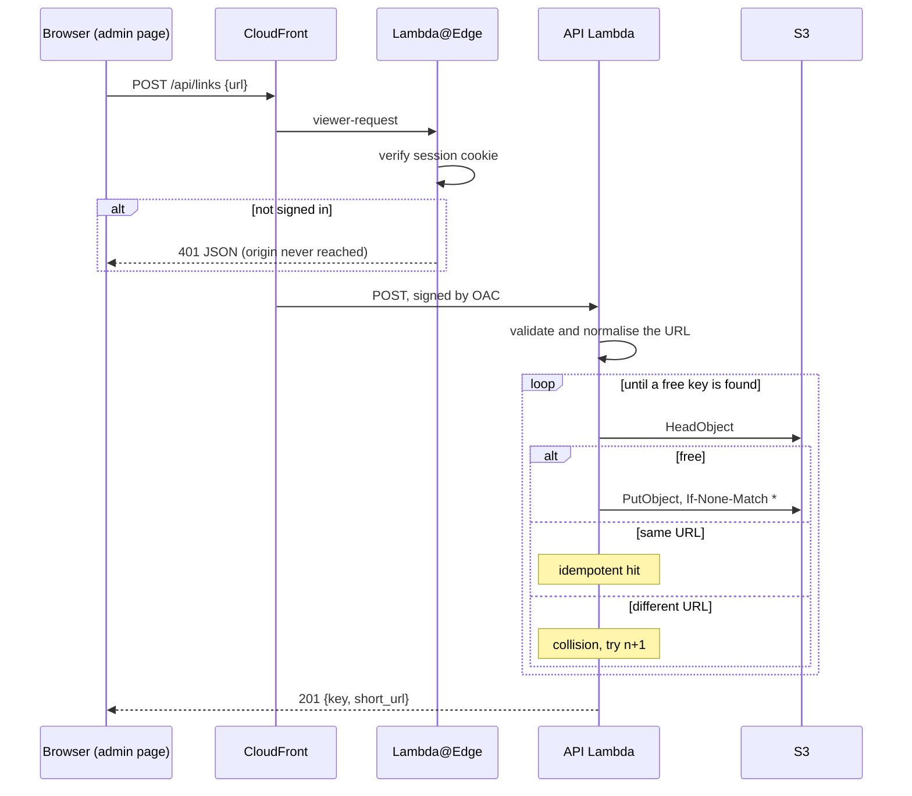
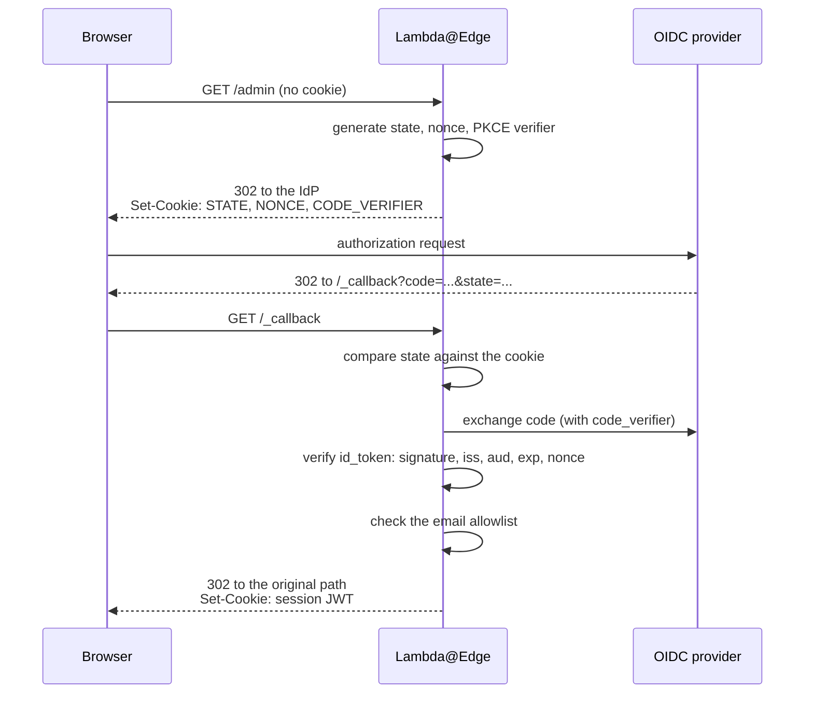

# Design

Why this is built the way it is, including the parts that are compromises.

---

## 1. Scope

A URL shortener for one person. Paste a long URL, get a short one, follow it.
Nothing else.

**Not goals:** click tracking, link expiry, custom aliases, multiple users,
teams, an editing UI. Each is easy to add; none is here.

**Assumptions:** thousands of links at most, and traffic low enough that
throughput never enters the design. Short links themselves are public — the
only thing behind authentication is creating them.

### Terms

| Term | Meaning |
| --- | --- |
| target URL | The long URL being shortened |
| key | The ten-character identifier, and also the S3 object key. Keys minted before the switch described in 3.4 are eight characters |
| short link | `https://<domain>/<key>` |
| redirect path | Serving `/<key>`; no authentication, no code of ours |
| registration path | Creating a link; authenticated |

---

## 2. Architecture



### 2.1 Routing

One distribution. Path patterns decide the origin and whether authentication
applies. Evaluation is top to bottom.

| # | Pattern | Origin | Edge function | Auth | Methods | Cache |
| --- | --- | --- | --- | --- | --- | --- |
| 1 | `/_callback` | (answered at the edge) | yes | no | GET, HEAD | disabled |
| 2 | `/admin*` | S3 + OAC | yes | **yes** | GET, HEAD | disabled |
| 3 | `/api/*` | Lambda Function URL | yes | **yes** | GET, HEAD, OPTIONS, PUT, POST, PATCH, DELETE | disabled |
| 4 | `*` | S3 website endpoint | **none** | no | GET, HEAD | `Managed-CachingOptimized` |

Three things about this table matter more than they look.

**The default behaviour has no edge function.** The redirect path runs no code
of ours, so an authentication failure cannot take down existing short links.
This separation is the main structural decision in the design; preserve it.

**Only `/api/*` accepts writes.** CloudFront allows methods per behaviour, so
the redirect path stays read-only.

**`/api/*` needs `Managed-AllViewerExceptHostHeader`.** It forwards
`x-amz-content-sha256`, which the origin requires (see 4.1). `Host` must be
excluded because SigV4 has to sign the origin's hostname, not the viewer's.
The edge association also uses `include_body = false`: if the function received
and re-emitted the body, the hash the browser computed would stop matching what
OAC signs.

---

## 3. The redirect path

### 3.1 How it works

1. Hash the target URL with **SHA-256, truncated to 40 bits**, rendered as ten
   lowercase hex digits.
2. Create an S3 object under that key. **The body is zero bytes.**
3. Put the target URL in the object's `x-amz-website-redirect-location`
   metadata.
4. The S3 website endpoint turns that metadata into a `301`.



No database, no compute. That is the whole redirect path.

### 3.2 Why the website endpoint, and what it costs

**Only the S3 website endpoint interprets `x-amz-website-redirect-location` as
a redirect.** The REST endpoint returns the object instead — which is to say,
zero bytes — with the metadata as a response header. So the origin must be the
website endpoint, and that has consequences:

| Consequence | Detail |
| --- | --- |
| No OAC | Website endpoints are custom origins; CloudFront cannot sign requests to them |
| Origin traffic is HTTP | Website endpoints do not serve HTTPS |
| The bucket must allow anonymous reads | Website hosting requires a public `s3:GetObject` |

That last one is the uncomfortable part. CloudFront can be bypassed by hitting
the website endpoint directly, so a WAF or rate limit on the distribution would
be decorative.

**Mitigation.** CloudFront injects a secret into the `Referer` header, and the
bucket policy requires it:

```jsonc
{
  "Sid": "PublicReadGetObject",
  "Effect": "Allow",
  "Principal": "*",
  "Action": "s3:GetObject",
  "Resource": "arn:aws:s3:::<bucket>/*",
  "Condition": { "StringEquals": { "aws:Referer": "<32 random bytes>" } }
}
```

**The header name is not a free choice.** An arbitrary name like
`X-Origin-Secret` cannot work: CloudFront can add any header, but S3 has no
condition key for one. The only HTTP headers exposed as IAM condition keys are
`aws:Referer` and `aws:UserAgent`.

**And this is not a security boundary.** AWS explicitly says `aws:Referer` must
not be used to prevent unauthorized access, because clients control the value.
That warning targets the usual pattern of putting a public value there, and the
situation here is better on three counts — the secret is 32 random bytes,
CloudFront overwrites whatever `Referer` the viewer sent, and the value never
reaches a browser — but "better" is not "sound". Treat it as effective
obfuscation.

Practically: the bucket holds zero-byte objects, so the exposure if bypassed is
that someone learns which keys exist and where they point. `s3:ListBucket` is
not granted, so they cannot enumerate.

**Do not shorten URLs that are themselves secrets.**

### 3.3 The alternative, and why it was not taken

Close the bucket entirely: serve from the REST endpoint behind OAC, and
synthesise the `301` in a CloudFront Function or Lambda@Edge that reads
`x-amz-website-redirect-location` off the origin response.

| | Referer (chosen) | REST + OAC |
| --- | --- | --- |
| Bucket | anonymous reads required | **fully private** |
| Protection | a shared secret | **SigV4 — a real boundary** |
| Public access block | must stay relaxed | **all settings on** |
| Redirect path | no code | depends on an edge function |
| Unverified | nothing | whether CloudFront passes the metadata header through to a viewer-response function |

Availability won: keeping compute out of the redirect path is worth more here
than closing a bucket of empty objects. Revisit this if you ever need a WAF, a
rate limit, or want to shorten sensitive URLs.

### 3.4 Key derivation and collisions



```
n = 0:  material = url
n > 0:  material = url + NUL + n
```

**The separator is NUL, not `#`.** With `#`, registering `url#1` on the first
attempt and retrying `url` on the second would produce identical hash input.
NUL cannot appear in a URL.

**The stored redirect always equals the input URL.** The counter only ever
enters the hash input. An earlier approach appended query parameters to the URL
on collision, which changed where the link actually went.

**Writes are conditional** (`If-None-Match: *`). Between the existence check
and the write, another request could take the key; the conditional write fails
with 412 rather than clobbering it. On failure the key is re-read: same URL
means return it, different URL means move to the next attempt.

Retry limit is 16, after which the request fails with 409.

**Keys were CRC32 and eight digits until QR codes arrived.** The width is not
about collisions — 32 bits was ample for the scale here. It is that short links
are unauthenticated, so the key is the only thing between a passer-by and the
target, and 4.3 billion is a space you can sweep. Printing links onto stickers
made that concrete enough to act on (docs/qr-codes.md 2). CRC32 caps the key at
32 bits, so widening it meant changing the hash as well.

**The cutover keeps old links working and gives up idempotency across it.**
Lookups accept both lengths, and the redirect path never ran this code at all,
so every key already issued still resolves. But `compute_key` now returns a
different key for a URL registered under the old scheme, so re-shortening one
mints a second key pointing at the same target. Chosen over carrying a CRC32
fallback in the create path: the fallback costs a `HeadObject` on every
registration, forever, to protect a case that arises when you paste an old URL
in again — and when it does, both links work.

### 3.5 How likely a collision is

Ten hex digits is 40 bits, about 1.1 trillion values. By the birthday bound:

| Links | Probability of at least one collision |
| --- | --- |
| 1,000 | 0.000045 % |
| 10,000 | 0.0045 % |
| 481,342 | 10 % |
| 1,234,604 | 50 % |

Two orders of magnitude of headroom over the previous 32-bit keys, and at the
intended scale collisions simply do not happen. The retry loop stays anyway;
it costs nothing when it never runs.

**Truncating SHA-256 is not the same as using it.** Forty bits is far too few
to resist a determined search for a *specific* key — 2^40 is minutes of work
offline. What the change buys is that finding a collision now requires that
search rather than solving a linear equation, which is what CRC32 offered.
Registration being authenticated is still what makes deliberate collisions
moot; the wider key is about the unauthenticated read side.

---

## 4. The registration API

### 4.1 Shape

| Piece | Implementation |
| --- | --- |
| Admin page | One static HTML file on S3, private behind OAC |
| API | Lambda (Python, arm64) behind a Function URL, `AuthType = AWS_IAM` |
| Auth | Lambda@Edge, shared with the other protected paths |

**A Function URL rather than API Gateway.** It keeps everything on one
distribution, so authentication lives in one place and there is no CORS to
manage. API Gateway's usage plans and stages would go unused at this scale.

**The catch.** OAC signs origin requests with SigV4, and **Lambda rejects
unsigned payloads**, so for `POST` the caller must compute the SHA-256 of the
body and send it as `x-amz-content-sha256`. The admin page does this with
`crypto.subtle.digest`. It also needs both `lambda:InvokeFunctionUrl` and
`lambda:InvokeFunction` in the resource policy — function URLs created from
October 2025 onward check both, and granting only the first produces a bare 403
that direct signed calls do not reproduce.

### 4.2 Registration flow



### 4.3 Validation and normalisation

Rejected:

- Anything but `http` and `https` — `javascript:`, `data:`, `file:` explicitly
- URLs longer than 2,048 characters
- `localhost`, loopback, private, link-local and reserved addresses
- **Credentials in the URL.** `https://trusted.com@evil.example/` is a standard
  phishing disguise and a redirector must not pass it on

Normalised:

- Surrounding whitespace trimmed
- Scheme and host lowercased
- Default ports (`:80`, `:443`) dropped
- Empty path becomes `/`
- IPv6 literals keep their brackets

**Query strings are never reordered and tracking parameters are never
stripped.** Both change what the target site does. The gain in idempotency is
not worth altering someone's URL.

### 4.4 IAM

| Action | Resource | Why |
| --- | --- | --- |
| `s3:GetObject`, `s3:PutObject` | `<bucket>/*` | Read and write redirect objects |
| `s3:ListBucket` | `<bucket>` | **Required — see below** |

`s3:DeleteObject` is not granted; the API cannot remove links.

> **Why `s3:ListBucket` is not optional.** There is no listing endpoint, so it
> looks like surplus permission. But `HeadObject` on a key that does not exist
> returns **403 rather than 404** when the caller cannot list the bucket — S3
> hides existence from those callers. Collision resolution asks "is this key
> free?" on every request, so without it the very first lookup fails, and the
> error points at `s3:GetObject`, which is fine.
>
> Grant it on the bucket itself, with no `/*`.

### 4.5 API

`POST /api/links` — create a link. Idempotent: the same URL returns the same
key with `existing: true` and `200` instead of `201`.

```jsonc
// request
{ "url": "https://example.com/long/path?a=1" }

// 201 Created
{
  "key": "1a2b3c4d5e",
  "short_url": "https://your.domain/1a2b3c4d5e",
  "target_url": "https://example.com/long/path?a=1",
  "created_at": "2026-01-01T00:00:00Z",
  "existing": false
}
```

`GET /api/links/{key}` — look up a key. `200` with the same shape, or `404`.

| Status | `error` | Meaning |
| --- | --- | --- |
| 400 | `invalid_url` / `invalid_request` / `invalid_key` | Bad input |
| 401 | `unauthorized` | No valid session (returned by the edge) |
| 403 | — | Signed in, but not on the allowlist |
| 404 | `not_found` | No such key or path |
| 405 | `method_not_allowed` | Wrong method for the path |
| 409 | `collision_exhausted` | 16 attempts without finding a free key |
| 415 | `invalid_request` | `Content-Type` is not `application/json` |
| 500 | `internal_error` | Unexpected |

Requiring JSON is a cheap CSRF guard: it puts the request outside what a form
can send cross-site.

---

## 5. Authentication

OIDC authorization code flow with PKCE, run in a **viewer-request Lambda@Edge**
on `/admin*`, `/api/*` and `/_callback`. The redirect path is untouched.

### 5.1 Why Lambda@Edge and not CloudFront Functions

| | CloudFront Functions | Lambda@Edge |
| --- | --- | --- |
| Network access | **none** | yes |
| Runtime | sub-millisecond | 5 s (viewer) |
| Package | — | **1 MB (viewer)** |
| Memory | — | **128 MB (viewer)** |
| Environment variables | no | **no** |
| Region | global | **us-east-1 only** |

Exchanging an authorization code requires an HTTP call to the IdP, which
CloudFront Functions cannot make. That settles it.

### 5.2 Flow



### 5.3 Decisions

**Authorization, not just authentication.** A verified email must appear on an
explicit allowlist. Without it, every account at the IdP could sign in.

**The allowlist is re-checked on every request**, not trusted for the life of a
session. Removing someone takes effect within the config TTL rather than at
token expiry.

**A rejected account gets 403, not another redirect.** Signing in again cannot
change the answer, so bouncing back to the IdP would loop forever.

**`state` is a CSRF token**, formed as `<random>.<base64url(return path)>`. The
random half is echoed in a cookie and compared on callback. Carrying only the
return path — with nothing to compare — leaves the callback open to login CSRF.

**The return path is validated.** `//evil.example` is protocol-relative and
browsers treat it as absolute, which would make the login flow itself an open
redirect. Backslashes and control characters are rejected too; anything
suspicious falls back to `/`.

**The session is our own JWT** (RS256, `HttpOnly; Secure; SameSite=Lax`),
not the IdP's `id_token`. `SameSite=Lax` is required so the cookie survives the
IdP's top-level redirect back.

**`/api/*` gets 401 JSON, never a 302.** `fetch` follows redirects, so
redirecting an XHR to the IdP surfaces as an inscrutable CORS error.

**The id_token's `aud` and `iss` are verified.** Without them a token minted
for a different client could be replayed.

### 5.4 Configuration and caching

Lambda@Edge has no environment variables, so configuration is a base64 JSON
blob in Secrets Manager, and the secret's *name* is compiled into the bundle at
build time.

| Cached | TTL | Reason |
| --- | --- | --- |
| Config | 15 min | Allowlist edits should not need a redeploy |
| Discovery document | 24 h | Rarely changes; skippable entirely (below) |
| JWKS | 1 h | **The IdP rotates signing keys** |

A failed load is never cached — the assignment does not happen — so populating
the secret after the first deploy works without republishing.

**Two things keep this inside the 5-second budget.** Verifying a session cookie
is purely local, so the common path makes no network calls at all; and the
discovery document and JWKS are fetched only where they are needed, which is
the callback. Supplying the IdP's endpoints directly in the config removes even
the discovery fetch. An unknown `kid` also forces an immediate JWKS refresh, so
a key rotation does not lock everyone out for an hour.

---

## 6. Data model

There is no database. **The S3 object is the record.**

| Field | Where |
| --- | --- |
| key | Object key |
| target URL | `x-amz-website-redirect-location` |
| created at | `x-amz-meta-created-at` |
| created by | `x-amz-meta-created-by` |
| body | zero bytes |

Consequences: listing means `ListObjectsV2` plus a `HeadObject` per key, so a
future list view needs paging. There is no reverse index, but the key is a
deterministic function of the URL, so recomputing it is the lookup — except for
collisions, where the counter is not recoverable. Bucket versioning is the only
route back from a bad delete.

---

## 7. Infrastructure

Terraform, excluding DNS.

```
terraform/
├── backend.tf          # empty backend block; values in backend.hcl (gitignored)
├── versions.tf
├── variables.tf
├── s3.tf               # redirect bucket and its policy
├── cloudfront.tf       # distribution, origins, behaviours
├── admin_site.tf       # admin bucket, OAC, the page object
├── lambda_api.tf       # registration API, Function URL, OAC, permissions
├── lambda_edge.tf      # edge authenticator (us-east-1), secret container
└── outputs.tf
```

### 7.1 Lambda@Edge constraints

- **us-east-1**, whatever region everything else uses
- CloudFront needs a **numbered version**; `$LATEST` and aliases are rejected
- The execution role must trust **both** `lambda.amazonaws.com` and
  `edgelambda.amazonaws.com`
- No environment variables, no layers, no VPC, **no arm64**
- Viewer events: 1 MB package, 128 MB memory, 5 s timeout
- **Replicas take hours to delete.** Removing the association does not
  immediately allow `destroy`; prefer publishing a new version to recreating
- **Logs go to the region nearest the viewer**, in a log group named
  `/aws/lambda/us-east-1.<function>`. Nothing appears in us-east-1

### 7.2 Secrets

Nothing sensitive belongs in Terraform state, so the boundary is drawn once:
Terraform creates the Secrets Manager entry, and `scripts/edge-auth-config.sh`
fills it. The OIDC client secret and the session signing key never pass through
Terraform.

The origin secret is the exception — it is a variable, so it does reach state.
State lives in a private, encrypted, versioned bucket.

### 7.3 DNS

Not managed here. Point a `CNAME` at the distribution and issue the certificate
however suits your provider; `acm_certificate_arn` is an input for exactly that
reason.

If your DNS sits behind a proxying CDN, **turn the proxy off for this record**.
Stacking a CDN in front of CloudFront gives you two TLS terminations, two
caches for a `301` you already cannot revoke, and interference with request
signing.

---

## 8. Security and limitations

### 8.1 Threats and what is done about them

| Threat | Response |
| --- | --- |
| Becoming an open redirector | Registration is behind OIDC with an explicit allowlist; the API is reachable only through CloudFront |
| Dangerous schemes | `http` and `https` only |
| Phishing via URL credentials | `user:pass@host` rejected |
| Origin bypass | Secret `Referer` (3.2). **Obfuscation, not a boundary** |
| Key enumeration | 40-bit keys (3.5). Sweeping them costs 1.1 trillion requests, billed to you, and a targeted guess needs the exact target URL. Better than the 32 bits this replaced, still **not a substitute for access control** |
| Deliberate collisions | Possible in principle; registration being authenticated is what makes it moot |
| A short link on a printed QR sticker | Readable by anyone who can see it, and unrecallable. Decide per link; docs/qr-codes.md 2 |
| Session theft | `HttpOnly; Secure; SameSite=Lax`, 12-hour expiry |
| CSRF | `SameSite=Lax`, JSON content type required, `state` verified on callback |
| Code interception | PKCE (S256), `state` and `nonce` verified |
| Secret exposure | Client secret and signing key live only in Secrets Manager |
| Cost runaway | Billing alarm. No WAF — disproportionate at this scale |
| Certificate expiry | ACM renews only while its DNS validation record survives. Deleting it breaks renewal silently |
| No audit trail | CloudFront access logs are not enabled |

### 8.2 Accepted limitations

- **`301` responses are cached hard by browsers.** Once a key is handed out,
  changing where it points will not reach anyone who already followed it.
  Treat short links as immutable.
- **The redirect bucket cannot be fully private.** `BlockPublicPolicy` and
  `RestrictPublicBuckets` must stay off: a policy containing `Principal: "*"`
  counts as public even with a condition attached. Closing this requires the
  migration in 3.3.
- **No click tracking.** CloudFront access logs would allow after-the-fact
  analysis; nothing is real-time.
- **No custom aliases, no expiry.**
- **CloudFront changes take minutes to propagate**, which sets the pace of any
  change touching the distribution.
- **us-east-1 is mandatory** for the certificate and the edge function.
- **DNS is outside the code**, so disaster recovery includes a manual step.

### 8.3 Availability

The redirect path has no compute and inherits AWS's managed SLAs directly. **If
registration or authentication breaks, redirects keep working.** That is the
point of keeping edge functions off the default behaviour, and it is the
property to protect when changing anything here.

---

## 9. Possible extensions

| Idea | Note |
| --- | --- |
| Custom aliases | Needs reserved-word checks against `/admin`, `/api`, `/_callback` |
| List and delete UI | Watch the N+1 in `ListObjectsV2` + `HeadObject` |
| Click analytics | CloudFront logs into Athena; cheap if you can wait |
| Expiry | S3 lifecycle rules, driven by tags |
| QR codes | Generate client-side; no server work. Designed in docs/qr-codes.md |
| Custom key widths per link | `KEY_BYTES` is global. Per-link widths would need the length recorded somewhere, and the key is the only record there is |

---

## 10. Decisions at a glance

| # | Decision | Because |
| --- | --- | --- |
| 1 | S3 website endpoint + redirect metadata | No compute in the redirect path |
| 2 | Collision handling salts the hash, not the URL | The stored redirect must equal the input |
| 3 | Lambda Function URL, not API Gateway | One distribution, one place for auth, no CORS |
| 4 | Lambda@Edge for OIDC | CloudFront Functions cannot reach the network |
| 5 | Only `/admin*`, `/api/*`, `/_callback` are protected | Redirect availability, cost and latency |
| 6 | Terraform, excluding DNS | One state across two regions; DNS varies per user |
| 7 | S3 objects as the datastore | Sufficient at this scale, one less component |
| 8 | `Referer` secret over REST + OAC | Availability over closing a bucket of empty objects |
| 9 | 40-bit truncated SHA-256 keys, no fallback to the old ones | Short links are unauthenticated and now get printed; 32 bits is sweepable |

---

## Appendix: references

- [S3 — configuring a page redirect](https://docs.aws.amazon.com/AmazonS3/latest/userguide/how-to-page-redirect.html)
- [S3 — website endpoints vs REST endpoints](https://docs.aws.amazon.com/AmazonS3/latest/userguide/WebsiteEndpoints.html)
- [S3 — conditional writes](https://docs.aws.amazon.com/AmazonS3/latest/userguide/conditional-writes.html)
- [CloudFront — restrictions on edge functions](https://docs.aws.amazon.com/AmazonCloudFront/latest/DeveloperGuide/edge-function-restrictions-all.html)
- [CloudFront — Lambda@Edge restrictions](https://docs.aws.amazon.com/AmazonCloudFront/latest/DeveloperGuide/lambda-at-edge-function-restrictions.html)
- [CloudFront — OAC for Lambda function URLs](https://docs.aws.amazon.com/AmazonCloudFront/latest/DeveloperGuide/private-content-restricting-access-to-lambda.html)
- [CloudFront — adding custom headers to origin requests](https://docs.aws.amazon.com/AmazonCloudFront/latest/DeveloperGuide/add-origin-custom-headers.html)
- [IAM — global condition context keys](https://docs.aws.amazon.com/IAM/latest/UserGuide/reference_policies_condition-keys.html)
